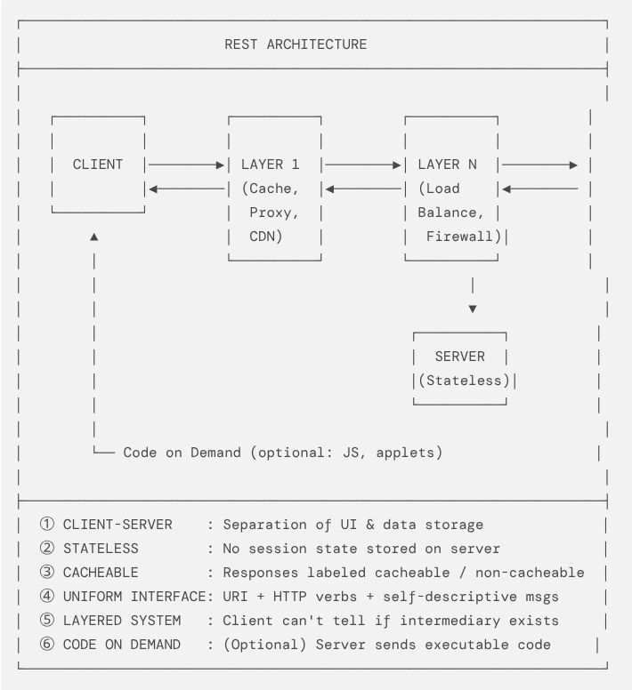

# REST

## Introduction:
REpresentational State Transfer (REST) is an architectural style (like a set of conventions) used for communication between the components of a system over the Internet.

REST is widely used in communication between distributed systems as it facilitates scalability.
Also, there is a very clear distinction that REST is an architectural style, not a protocol.

## Six Architectural Constraints:
1. **Client-Server:** This points towards separation of concerns between the components.
2. **Stateless:** This represents that every API request should be made such that its response does not depends on the previously established state.
3. **Cacheable:** This points towards improving the efficiency by not making extra requests, when it can respond to that simply by caching.
4. **Uniform Interface:** There must be some common interface, taken into consideration by both the requesting and responding sides to maintain the uniformity.
5. **Layered System:** There can be any number of layers (e.g., Load Balancers) that can be present and either of them will be responding to the request, but are always hidden and should not be known by the requesting system.
6. **Code-on-Demand (optional):** This is an optional constraint which is also provided, on-demand, by the servers, to provide executable code to clients (e.g., JavaScript code, used to run on client machines).

## REST Architectural Elements:
It has basically three main categories:
* **Data Elements:** This mainly consists of resources, representations, metadata, etc.
* **Connectors:** This includes client, server, cache, etc.
* **Components:** This includes user agent, origin server, proxies, gateways, etc.

## How REST Works:
With the help of an example of an e-commerce system, we will try to understand how this system works:
* `GET /products` : To get the list of all the products.
* `POST /products` : To create a new product entry.
* `PUT /products/101` : To update a specific product.
* `PATCH /products/101` : To replace a specific product.
* `DELETE /products/101` : To delete a specific product.

The above API requests follow the REST constraints. The client sends HTTP request and gets a response from the server, usually in the JSON format.

## Advantages and Limitations:
- **Advantages:**  Efficient caching, scalability, independent client-server development, etc.
- **Disadvantages:**  Redundant data in stateless requests, latency due to layers, etc.

## Conclusion:
REST acts as the backbone of uninterrupted communication between the components, adhering to uniformity, over the Internet. 

## References:
- Amazon Web Services (AWS). "[What is RESTful API?](https://aws.amazon.com/what-is/restful-api/)".
- REST API Tutorial. "[The Six Constraints](https://www.restapitutorial.com/introduction/restconstraints)".
- Fielding, Roy T. (2000). "[Representational State Transfer (REST), Chapter 5](https://www.ics.uci.edu/~fielding/pubs/dissertation/rest_arch_style.htm)".
